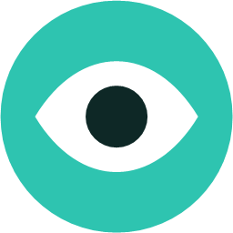
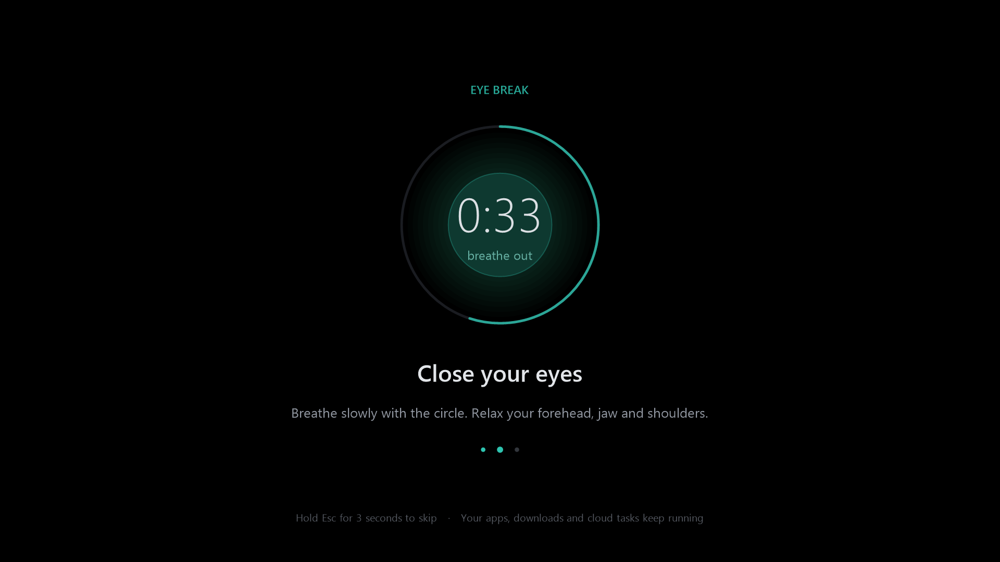
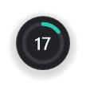
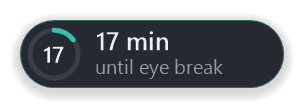
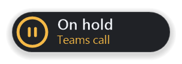

<p align="center"></p>

<h1 align="center">EyeBreak</h1>

<p align="center">A guided 1-minute eye break every 20 minutes, for Windows.<br>
It waits for your meetings and presentations, and your work keeps running underneath.</p>

<p align="center"><a href="https://github.com/agresh-agrawal/eyebreak/releases/latest/download/EyeBreak.exe"><b>Download EyeBreak.exe</b></a></p>



## What it does

- **A tiny badge**: a 34 px ring that stays on top of everything, fullscreen games included. It shows the minutes left and opens on hover. Drag it anywhere and it remembers the spot.
- **Every 20 minutes the screen fades to black** for a guided minute: look far away, close your eyes and breathe with the circle, then blink and roll. The keyboard pauses so you actually rest. Hold `Esc` for 3 seconds to skip in an emergency.
- **Meeting and presentation aware.** If the camera is on, a call app (Teams, Zoom, Meet, Webex, Slack, Discord and more) is using the mic, or you're presenting (PowerPoint slideshow, presentation mode, fullscreen Slides/Keynote/Canva), the break waits and starts about a minute after it ends. If an unknown app is using the mic, it asks once and remembers your answer.
- **Never stops your work.** The break is only a window on top, so builds, downloads and cloud jobs keep going.
- **Lock or sleep for 1+ minute** counts as a rest, so the timer restarts.
- **Click the badge** for status, today's break count, *Take a break now*, *Restart timer*, *Quit* and *Uninstall*.

| | | |
|---|---|---|
|  |  |  |

## Install

Download `EyeBreak.exe` and run it. It copies itself to `%LOCALAPPDATA%\Programs\EyeBreak`, starts with Windows, and replaces any older running copy. To update, run a newer exe. To remove it, use **Uninstall** in the badge's panel.

SmartScreen may warn because the exe isn't code-signed: click *More info*, then *Run anyway*.

## Build

Requires Rust (GNU or MSVC toolchain).

```powershell
.\build-release.ps1            # -> dist\EyeBreak.exe
.\build-release.ps1 -Install   # build and install on this PC
```

Flags: `--test` (20 s work / 15 s break, no install), `--portable` (don't self-install), `--detect` (writes the meeting-detection result to `%TEMP%\eyebreak-detect.txt`), `--preview <dir>` (renders every screen to PNG).

`assets/resources.obj` holds the exe icon and version info, compiled from `assets/app.rc`. `build-release.ps1` regenerates it when the Windows SDK and MSVC build tools are installed.

## Download page

`site/` is a static page deployed on Vercel. Its download button points at the latest GitHub release asset `EyeBreak.exe`.
